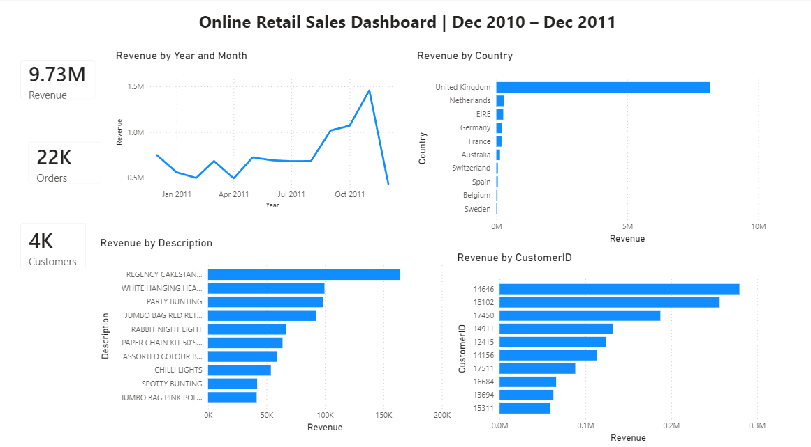

# Online Retail Sales & Customer Analytics

## Overview

An end-to-end analytics project analysing transaction data from a UK-based online gift retailer - cleaning the raw data, loading it into a relational database, writing SQL analysis, and building an interactive Power BI dashboard connected live to the database.

## Dataset

- **Online Retail Dataset** (Kaggle, by Ulrik Thyge Pedersen) - real transaction data from a UK online retailer
- ~541,909 rows before cleaning
- Columns: InvoiceNo, StockCode, Description, Quantity, InvoiceDate, UnitPrice, CustomerID, Country

## Data Cleaning (Excel)

- Found 135,080 rows with blank CustomerID - kept them, but filtered out for any customer-level analysis
- Found 10,624 cancellation rows (InvoiceNo starting with "C", representing returns/negative quantity) - kept for return-analysis purposes but excluded from total sales figures
- Removed 5,268 exact duplicate rows
- Fixed InvoiceDate, which was stored as text, into a proper date format

## Database & SQL

- Loaded the cleaned data (536,641 rows) into MySQL using `LOAD DATA LOCAL INFILE`, after the Table Data Import Wizard proved too slow for a dataset this size
- Fixed a hidden BOM character in the InvoiceNo column name, and converted InvoiceDate into a proper DATETIME column
- Wrote SQL queries to analyse:
  - Total revenue (excluding cancellations)
  - Revenue by month
  - Top-selling products (excluding non-product codes like POST, DOT, BANK CHARGES)
  - Top countries by revenue
  - Top customers by revenue (excluding guest/unidentified purchases)

Full queries are in [`online_retail_analysis.sql`](online_retail_analysis.sql).

## Dashboard (Power BI)

Built an interactive one-page Power BI dashboard connected live to the MySQL database: a monthly revenue trend plus Top-N bar charts for products, countries and customers, with cross-filtering across all visuals - so clicking one chart filters the rest automatically.

<!-- TODO: upload a dashboard screenshot as dashboard.png, then add:  -->

## Key Findings

| Metric | Value |
|---|---|
| Gross sales (cancelled invoices excluded) | **£10.62M** across 22,064 orders |
| Net revenue (after subtracting cancellations) | **£9,726,006.95** |
| Revenue from the United Kingdom | **84.6%** (38 countries in total) |
| Share of customer revenue from the top 10% of 4,339 customers | **61%** |
| Peak month | **November 2011** - £1.50M, about double the monthly average |

- **Customer-concentration risk:** a single Netherlands customer generated roughly **£280,000**, about **98% of all Netherlands revenue** - that country's sales depend almost entirely on one buyer
- Netherlands (~£3,005) and Ireland (~£983) have much higher average order values than Germany (~£500), France (~£535) or the UK (~£446), driven by a few large wholesale-style accounts
- Revenue is highly concentrated: the top 1% of customers drive ~32% of customer revenue
- Several of the largest single orders were later cancelled in full, so product rankings were checked against cancellations before drawing conclusions

## Recommendations

- Protect key accounts with dedicated account management, given the dependence on a small group of customers
- Plan stock and staffing ahead of the September-November peak
- Use the high-value international accounts as a base for growth outside the UK

## Tools & Technologies

- Excel - data cleaning
- MySQL - database, data loading, SQL analysis
- Power BI - live-connected interactive dashboard
